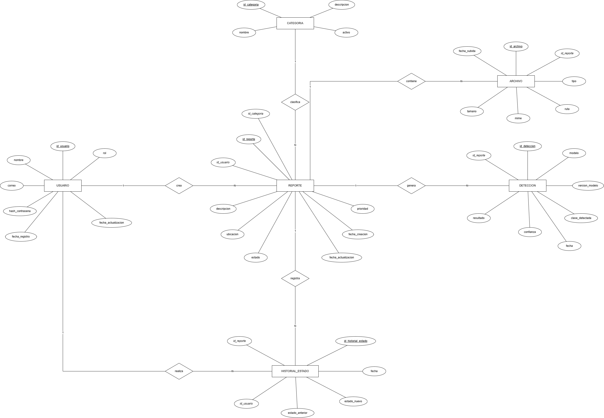

# Modelo de datos de URBIA — Diagrama E-R y restricciones

> **Historia de usuario 02.1 — Diseñar el esquema relacional de URBIA**
> Módulo 02 — Base de datos y modelo de información · Backend — MVP
> Motor: PostgreSQL + PostGIS

## 1. Diagrama entidad-relación (notación Chen)

Fuente editable: [`urbia-er.drawio`](./urbia-er.drawio)

**Cómo leer el diagrama**

| Símbolo | Significado |
|---|---|
| Rectángulo | Entidad (tabla) |
| Rombo | Relación |
| Óvalo | Atributo (todos son atómicos) |
| <u>subrayado</u> | Clave primaria (PK) |
| *cursiva* | Clave foránea (FK) |
| `1` / `N` | Cardinalidad de la relación |

**Convenciones de nombres**

- Las tablas van en singular y en minúsculas: `usuario`, `reporte`, `historial_estado`.
- La clave primaria siempre se llama `id_<tabla>`, por ejemplo `id_usuario`.
- Las claves foráneas se llaman igual que la PK a la que apuntan, por ejemplo `reporte.id_usuario`.
- Los atributos no llevan el nombre de la tabla como sufijo: se escribe `nombre`, no `nombre_usuario`.
- Las restricciones tienen nombre explícito:

| Tipo | Formato | Ejemplo |
|---|---|---|
| Clave primaria | `pk_<tabla>` | `pk_usuario` |
| Clave foránea | `fk_<tabla>_<tabla_referida>` | `fk_reporte_usuario` |
| Unicidad | `uq_<tabla>_<columna>` | `uq_usuario_correo` |
| Check | `ck_<tabla>_<columna>` | `ck_reporte_estado` |

## 2. Relaciones

| Relación | Entidades | Cardinalidad | Se implementa con |
|---|---|---|---|
| crea | USUARIO → REPORTE | 1 : N | `reporte.id_usuario` |
| clasifica | CATEGORIA → REPORTE | 1 : N | `reporte.id_categoria` |
| genera | REPORTE → DETECCION | 1 : N | `deteccion.id_reporte` |
| contiene | REPORTE → ARCHIVO | 1 : N | `archivo.id_reporte` |
| registra | REPORTE → HISTORIAL_ESTADO | 1 : N | `historial_estado.id_reporte` |
| realiza | USUARIO → HISTORIAL_ESTADO | 1 : N | `historial_estado.id_usuario` |

## 3. Restricciones por tabla

La columna **Nulo** dice si la columna acepta `NULL` (`No` = `NOT NULL`).

### 3.1 `usuario`

| Columna | Tipo | Nulo | Restricción |
|---|---|---|---|
| <u>id_usuario</u> | `BIGINT GENERATED ALWAYS AS IDENTITY` | No | `pk_usuario` |
| nombre | `VARCHAR(100)` | No | `ck_usuario_nombre`: `length(trim(nombre)) > 0` |
| correo | `VARCHAR(150)` | No | `uq_usuario_correo` (sobre `lower(correo)`); `ck_usuario_correo`: `correo LIKE '%_@_%._%'` |
| hash_contrasena | `VARCHAR(255)` | No | — |
| rol | `VARCHAR(20)` | No | `DEFAULT 'ciudadano'`; `ck_usuario_rol`: `rol IN ('ciudadano', 'administrador')` |
| fecha_registro | `TIMESTAMPTZ` | No | `DEFAULT now()` |
| fecha_actualizacion | `TIMESTAMPTZ` | No | `DEFAULT now()`; `ck_usuario_fechas`: `fecha_actualizacion >= fecha_registro` |

- La unicidad del correo se valida sin distinguir mayúsculas, para que `Ana@x.com` y `ana@x.com` cuenten como el mismo correo. Se implementa con un índice único sobre `lower(correo)`.
- Nunca se guarda la contraseña en texto plano, solo su hash (bcrypt o argon2).

### 3.2 `categoria`

| Columna | Tipo | Nulo | Restricción |
|---|---|---|---|
| <u>id_categoria</u> | `SMALLINT GENERATED ALWAYS AS IDENTITY` | No | `pk_categoria` |
| nombre | `VARCHAR(60)` | No | `uq_categoria_nombre` (sobre `lower(nombre)`) |
| descripcion | `VARCHAR(255)` | Sí | — |
| activo | `BOOLEAN` | No | `DEFAULT TRUE` |

- Una categoría que ya no se usa se marca con `activo = FALSE` en lugar de borrarla, porque puede haber reportes que la referencian.

### 3.3 `reporte`

| Columna | Tipo | Nulo | Restricción |
|---|---|---|---|
| <u>id_reporte</u> | `BIGINT GENERATED ALWAYS AS IDENTITY` | No | `pk_reporte` |
| *id_usuario* | `BIGINT` | No | `fk_reporte_usuario` → `usuario(id_usuario)` |
| *id_categoria* | `SMALLINT` | Sí | `fk_reporte_categoria` → `categoria(id_categoria)` |
| descripcion | `TEXT` | No | `ck_reporte_descripcion`: `length(trim(descripcion)) BETWEEN 10 AND 1000` |
| ubicacion | `GEOMETRY(Point, 4326)` | No | Tipo PostGIS, en coordenadas WGS84 (las del GPS) |
| estado | `VARCHAR(20)` | No | `DEFAULT 'pendiente'`; `ck_reporte_estado`: `estado IN ('pendiente', 'en_revision', 'en_proceso', 'resuelto', 'rechazado')` |
| prioridad | `VARCHAR(10)` | No | `DEFAULT 'media'`; `ck_reporte_prioridad`: `prioridad IN ('baja', 'media', 'alta')` |
| fecha_creacion | `TIMESTAMPTZ` | No | `DEFAULT now()` |
| fecha_actualizacion | `TIMESTAMPTZ` | No | `DEFAULT now()`; `ck_reporte_fechas`: `fecha_actualizacion >= fecha_creacion` |

- `id_categoria` acepta `NULL` porque guarda la **categoría confirmada**. Mientras el modelo de IA o el administrador no la confirman, el reporte puede no tener categoría.
- Los valores de `estado`, `rol` y `prioridad` son una propuesta. Se cierran en la HU 02.4 (estados, roles y categorías).

### 3.4 `deteccion`

| Columna | Tipo | Nulo | Restricción |
|---|---|---|---|
| <u>id_deteccion</u> | `BIGINT GENERATED ALWAYS AS IDENTITY` | No | `pk_deteccion` |
| *id_reporte* | `BIGINT` | No | `fk_deteccion_reporte` → `reporte(id_reporte)` |
| modelo | `VARCHAR(60)` | No | — |
| version_modelo | `VARCHAR(20)` | No | — |
| clase_detectada | `VARCHAR(60)` | Sí | — |
| confianza | `NUMERIC(5,4)` | Sí | `ck_deteccion_confianza`: `confianza BETWEEN 0 AND 1` |
| resultado | `VARCHAR(20)` | No | `ck_deteccion_resultado`: `resultado IN ('detectado', 'no_detectado', 'error')` |
| fecha | `TIMESTAMPTZ` | No | `DEFAULT now()` |

- `clase_detectada` y `confianza` aceptan `NULL` porque, cuando `resultado` es `'no_detectado'` o `'error'`, el modelo no devuelve una clase ni una confianza.
- Esto se asegura con `ck_deteccion_consistencia`:
  `resultado <> 'detectado' OR (clase_detectada IS NOT NULL AND confianza IS NOT NULL)`

### 3.5 `archivo`

| Columna | Tipo | Nulo | Restricción |
|---|---|---|---|
| <u>id_archivo</u> | `BIGINT GENERATED ALWAYS AS IDENTITY` | No | `pk_archivo` |
| *id_reporte* | `BIGINT` | No | `fk_archivo_reporte` → `reporte(id_reporte)` |
| tipo | `VARCHAR(20)` | No | `ck_archivo_tipo`: `tipo IN ('imagen', 'video')` |
| ruta | `VARCHAR(500)` | No | `uq_archivo_ruta` |
| mime | `VARCHAR(50)` | No | `ck_archivo_mime`: `mime IN ('image/jpeg', 'image/png', 'image/webp', 'video/mp4')` |
| tamano | `INTEGER` | No | `ck_archivo_tamano`: `tamano > 0 AND tamano <= 10485760` (10 MB, medido en bytes) |
| fecha_subida | `TIMESTAMPTZ` | No | `DEFAULT now()` |

- En la tabla solo se guarda la **ruta** del archivo; el archivo en sí vive en disco o en un almacenamiento de objetos. `uq_archivo_ruta` evita que dos registros apunten al mismo archivo.

### 3.6 `historial_estado`

| Columna | Tipo | Nulo | Restricción |
|---|---|---|---|
| <u>id_historial_estado</u> | `BIGINT GENERATED ALWAYS AS IDENTITY` | No | `pk_historial_estado` |
| *id_reporte* | `BIGINT` | No | `fk_historial_estado_reporte` → `reporte(id_reporte)` |
| *id_usuario* | `BIGINT` | No | `fk_historial_estado_usuario` → `usuario(id_usuario)` |
| estado_anterior | `VARCHAR(20)` | Sí | Mismo dominio que `reporte.estado` |
| estado_nuevo | `VARCHAR(20)` | No | Mismo dominio que `reporte.estado` |
| fecha | `TIMESTAMPTZ` | No | `DEFAULT now()` |

- `estado_anterior` es `NULL` solo en el primer registro de cada reporte, cuando nace como `'pendiente'`.
- `ck_historial_estado_cambio`: `estado_anterior IS NULL OR estado_anterior <> estado_nuevo` (no se registran "cambios" al mismo estado).
- Que `id_usuario` sea de un **administrador** no se puede garantizar con una FK ni con un CHECK, porque depende de otra tabla. Se valida en el backend o con un trigger.

## 4. Acciones referenciales (ON DELETE / ON UPDATE)

| FK | ON DELETE | Motivo |
|---|---|---|
| `fk_reporte_usuario` | `RESTRICT` | No se borra un usuario que tiene reportes |
| `fk_reporte_categoria` | `RESTRICT` | Las categorías se desactivan, no se borran |
| `fk_deteccion_reporte` | `CASCADE` | Una detección no tiene sentido sin su reporte |
| `fk_archivo_reporte` | `CASCADE` | Igual que la detección; el backend borra también el archivo físico |
| `fk_historial_estado_reporte` | `RESTRICT` | El historial es una bitácora de auditoría y no debe perderse |
| `fk_historial_estado_usuario` | `RESTRICT` | Se conserva quién hizo cada cambio |

En todas las FK, `ON UPDATE` es `NO ACTION`: las PK son de tipo identidad y no cambian.

## 5. Índices recomendados

PostgreSQL crea un índice automáticamente para cada PK y cada UNIQUE, pero **no para las FK**. Estos índices se crean a mano:

| Índice | Tabla (columnas) | Uso |
|---|---|---|
| `ix_reporte_id_usuario` | `reporte (id_usuario)` | Ver los reportes de un usuario |
| `ix_reporte_id_categoria` | `reporte (id_categoria)` | Filtrar reportes por categoría |
| `ix_reporte_estado` | `reporte (estado)` | Panel del administrador |
| `ix_reporte_ubicacion` | `reporte USING GIST (ubicacion)` | Consultas espaciales: reportes cercanos y mapa |
| `ix_deteccion_id_reporte` | `deteccion (id_reporte)` | Ver las detecciones de un reporte |
| `ix_archivo_id_reporte` | `archivo (id_reporte)` | Ver los archivos de un reporte |
| `ix_historial_estado_id_reporte` | `historial_estado (id_reporte, fecha)` | Línea de tiempo de un reporte |

## 6. Resumen de restricciones

| Tabla | PK | FK | UNIQUE | CHECK |
|---|---|---|---|---|
| usuario | id_usuario | — | correo | nombre, correo, rol, fechas |
| categoria | id_categoria | — | nombre | — |
| reporte | id_reporte | id_usuario, id_categoria | — | descripcion, estado, prioridad, fechas |
| deteccion | id_deteccion | id_reporte | — | confianza, resultado, consistencia |
| archivo | id_archivo | id_reporte | ruta | tipo, mime, tamano |
| historial_estado | id_historial_estado | id_reporte, id_usuario | — | cambio de estado |

## 7. Pendientes que dependen de otras historias

- **02.2 — Crear PostgreSQL con PostGIS:** habilitar `CREATE EXTENSION postgis;` antes de crear `reporte`.
- **02.3 — Implementar migraciones:** convertir este documento en el script DDL, respetando los nombres de las restricciones.
- **02.4 — Definir estados, roles y categorías:** confirmar los valores de los CHECK de `rol`, `estado` y `prioridad`, y cargar las categorías iniciales.
